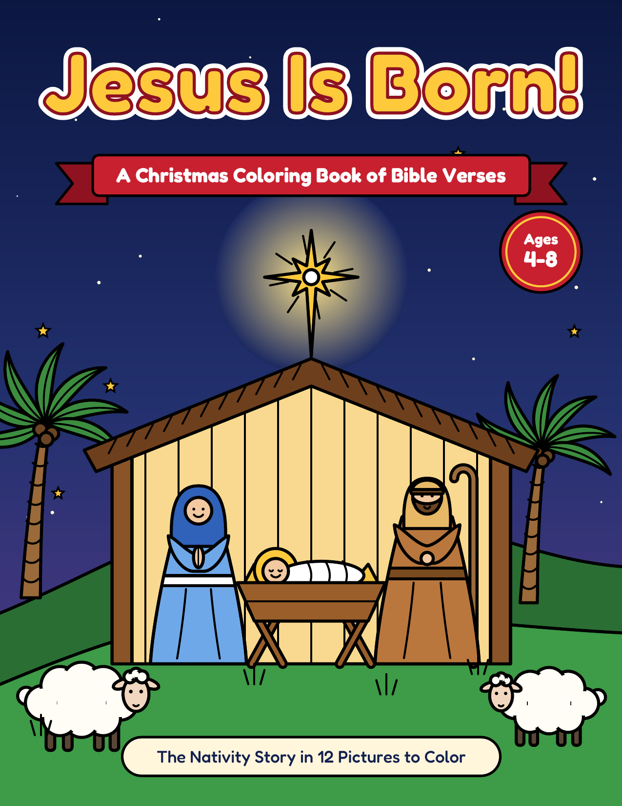

# Jesus Is Born! — A Christmas Coloring Book of Bible Verses

A Christian Christmas coloring book for kids (ages 4–8), ready to publish as an Amazon KDP paperback.



## KDP files (`kdp/`)

| File | Use | Spec |
|---|---|---|
| `interior.pdf` | Manuscript upload | 32 pages, 8.5 × 11 in, no bleed, black ink, all fonts embedded |
| `cover.pdf` | Cover upload (print-ready PDF) | 17.3221 × 11.25 in: back + 0.0721 in spine + front, 0.125 in bleed |
| `front-cover-preview.png` | Marketing image | Front cover only, 150 dpi |

KDP settings: **Black & white interior, white paper · 8.5 × 11 in · No Bleed · Glossy cover**.
The lower right of the back cover is left clear for the barcode KDP adds.

## What's inside

Each of the 12 coloring pages is printed on a right-hand page, with a "Test Your Colors" page on its back so markers don't bleed into the next picture.

| Page | Picture | Verse (KJV) | Theme |
|---|---|---|---|
| 1 | Title page to color | Luke 2:11 | — |
| 2 | Copyright | — | — |
| 3 | "This book belongs to", contents, note for parents & teachers | Luke 2:14 | — |
| 5 | God Promised a Savior | Isaiah 9:6 | Hope |
| 7 | Mary Says Yes to God | Luke 1:30-31 | Faith |
| 9 | The Trip to Bethlehem | Luke 2:4-5 | Trust |
| 11 | Born in a Manger | Luke 2:7 | Humility |
| 13 | Shepherds in the Field | Luke 2:8 | God Sees Everyone |
| 15 | Good News of Great Joy | Luke 2:10-11 | Joy |
| 17 | Glory to God! | Luke 2:14 | Praise & Peace |
| 19 | Following the Star | Matthew 2:2 | Seeking Jesus |
| 21 | Gifts for the King | Matthew 2:11 | Giving |
| 23 | His Name Is Emmanuel | Matthew 1:23 | God With Us |
| 25 | Jesus, the Light | John 8:12 | Light |
| 27 | God's Greatest Gift | John 3:16 | Love |
| 29 | Draw your favorite part of the story | — | — |
| 31 | My Christmas Prayer | — | — |
| 32 | Merry Christmas! Jesus Loves You! | 1 John 4:19 | — |

Every story page has a **theme word** and a **"Think about it"** question for families, Sunday school or children's church.

## Rebuilding

All artwork is drawn in code, so you can edit a verse, question or picture and rebuild:

```bash
pip install reportlab
python3 coloring-book/make_coloring_book.py --author "Your Name"   # interior
python3 coloring-book/make_cover.py --pages 32 --paper white        # cover
```

If the interior page count or paper type changes, rebuild the cover with the new `--pages`/`--paper` so the spine width matches.

Fonts: Fredoka (SIL Open Font License, `fonts/OFL-Fredoka.txt`) for titles; Liberation Sans/Serif from the system for body text. Scripture is from the King James Version (public domain).
